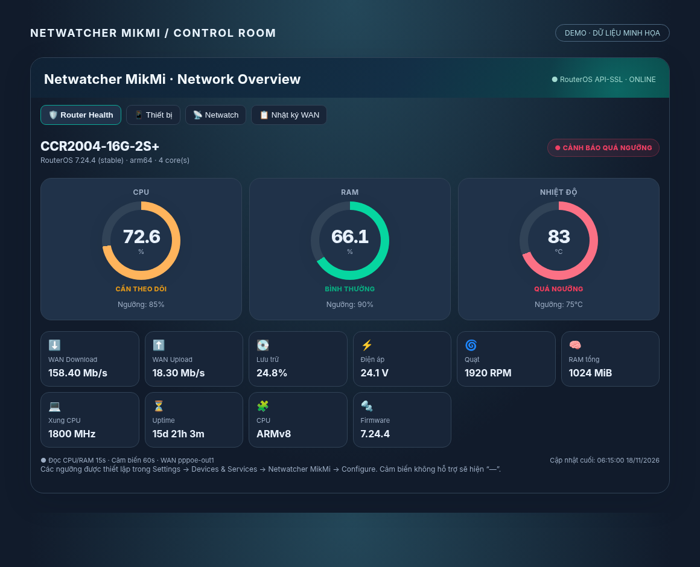
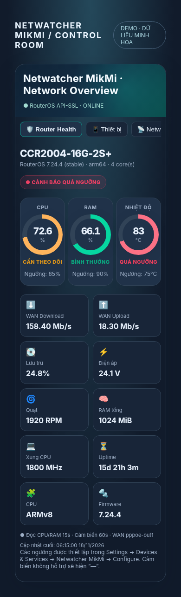

# Netwatcher MikMi — MikroTik, Xiaomi Mesh, Router Health, Zalo Bot và cảnh báo WAN

**Phiên bản:** `0.4.0-beta.1` · **Home Assistant custom integration** · ngôn ngữ UI English/Tiếng Việt · **beta, chưa xác nhận chạy trên thiết bị thật**.

> ⚠️ **BẢO MẬT VÀ AN TOÀN VẬN HÀNH:** Phần mềm này chỉ **đọc** RouterOS qua API-SSL, không tự thay firewall, không mở cổng, không chặn IP và không thay DHCP. Chỉ cài trên mạng do bạn sở hữu hoặc được phép quản trị. Sao lưu cấu hình MikroTik/Home Assistant, thao tác Safe Mode khi sửa firewall. Mọi kết luận “bất thường” là tín hiệu xem xét, **không phải bằng chứng đã bị xâm nhập**.

## MỚI TRONG v0.4 — Router Health + Netwatch + WAN throughput



<details><summary>Xem trước giao diện trên điện thoại (dữ liệu mô phỏng)</summary>



</details>

> Đây là ảnh **giao diện chạy JavaScript card với dữ liệu GIẢ**, không phải dữ liệu từ MikroTik của bạn. Mở `preview/router_health_demo.html` trong trình duyệt để xem thử (chỉ demo; không kết nối RouterOS).

### Điểm nổi bật

- Thêm luồng CPU/RAM riêng (mặc định 15 giây), dữ liệu cảm biến nhiệt độ/quạt/điện áp (60 giây) và RouterBOARD firmware (mỗi 10 phút). Nguồn log, Netwatch, Xiaomi và inventory cũng có bộ điều khiển chu kỳ riêng; không chờ I/O của nhau.
- Hiển thị CPU, RAM, nhiệt độ, lưu trữ, RAM tổng, số core CPU, xung nhịp, uptime, model, kiến trúc, RouterOS, firmware, voltage và tốc độ quạt (nếu phần cứng có cảm biến).
- Đọc /tool/netwatch/print **chỉ đọc** để xem trạng thái các phép kiểm tra Netwatch **đã có trên MikroTik**. Không tự thêm probe hoặc script; Netwatch tắt mặc định.
- Tính tốc độ WAN RX (download) / TX (upload) từ `rx-byte` và `tx-byte` trên `/interface/print`, chia theo **số giây thực tế** giữa hai lần lấy mẫu. Khi thiếu lượt đầu, reset counter hoặc interface sai: báo không có số liệu, **không lấy 0 giả**. Cần chọn tên WAN interface trong Options nếu không tự nhận PPPoE.
- Ba đồng hồ tròn trên Lovelace tự đổi màu xanh / vàng / đỏ theo ngưỡng, có trạng thái chữ nổi bật. Card có các tab Router Health, Thiết bị, Netwatch, Nhật ký WAN, cùng visual editor để chọn tab mặc định, bật/tắt bảng dữ liệu.
- Thông báo CPU / RAM / nhiệt độ có công tắc độc lập. **Mặc định tắt toàn bộ thông báo phần cứng**; bật trong Options khi bạn đã kiểm tra số đo thực tế và cấu hình Zalo Bot nếu muốn gửi ra Zalo thường.

### Hướng dẫn nâng cấp từ v0.3 mà không mất dữ liệu

1. Sao lưu thư mục cấu hình Home Assistant, dữ liệu `.storage` và bản export MikroTik. Không xóa config entry Netwatcher đang có.
2. Giải nén ZIP v0.4 rồi **ghi đè toàn bộ thư mục** `/config/custom_components/netwatcher_mikmi/` (không chép thêm một thư mục lồng `netwatcher-mikmi`).
3. Khởi động lại Home Assistant; vào **Settings → Devices & Services → Netwatcher MikMi → Configure**, lưu lại Options để xuất hiện các trường v0.4.
4. Truy cập dashboard: tài nguyên JS đã đăng ký trong storage mode tự đổi sang `?v=0.4.0-beta.1`. Nếu cần xóa cache trình duyệt hoặc hard refresh. Với Lovelace YAML resource, tự sửa URL. **Không thêm một resource trùng lặp**.
5. Mở tab **Router Health**, so sánh CPU/RAM/nhiệt độ và firmware với WinBox/Terminal. Chọn tên PPPoE của bạn trong tùy chọn `router_wan_interface` nếu WAN không được nhận diện.
6. Thử cảnh báo ngưỡng trên router thử nghiệm hoặc bằng cách đặt ngưỡng **trong phạm vi an toàn** trong thời gian ngắn, sau đó hoàn nguyên. Không tạo tải CPU cực lớn, không cố làm quá nhiệt router đang cấp Internet cho gia đình/doanh nghiệp.

Việc nâng cấp giữ `domain=netwatcher_mikmi`, unique ID cũ của cảm biến CPU (`router_cpu`), các config entry, inventory và Zalo Bot options. Cơ sở dữ liệu chống gửi trùng phần cứng được lưu độc lập bằng Home Assistant Storage; sau restart không phát lại thông báo cũ khi trạng thái vẫn quá ngưỡng.

### Cấu hình Router Health và ngưỡng cảnh báo

Mở **Settings → Devices & Services → Netwatcher MikMi → Configure**. Các trường chính:

| Tùy chọn | Mặc định | Ý nghĩa |
|---|---:|---|
| `hardware_poll_interval` | 15 giây | Chu kỳ đọc CPU/RAM từ `/system/resource` (10–300 giây) |
| `health_detail_poll_interval` | 60 giây | Chu kỳ đọc `/system/health` (30–600 giây; không nhỏ hơn CPU/RAM) |
| `hardware_alerts_enabled` | OFF | Công tắc tổng thông báo vượt ngưỡng |
| `hardware_cpu_alert_enabled` | ON | Cho phép cảnh báo CPU khi bật công tắc tổng |
| `hardware_ram_alert_enabled` | ON | Cho phép cảnh báo RAM khi bật công tắc tổng |
| `hardware_temperature_alert_enabled` | ON | Cảnh báo nhiệt độ khi firmware/hardware cung cấp sensor |
| `hardware_cpu_threshold` | 85% | Ngưỡng CPU |
| `hardware_ram_threshold` | 90% | Ngưỡng RAM đang sử dụng |
| `hardware_temperature_threshold` | 75 °C | Ngưỡng cảm biến nhiệt độ ưu tiên CPU |
| `hardware_confirm_samples` | 3 lần | Số **lượt đo mới** liên tiếp phải vượt ngưỡng trước khi cảnh báo |
| `hardware_cooldown_minutes` | 30 phút | Chống lặp khi chỉ số dao động qua ngưỡng |
| `hardware_notify_recovery` | ON | Có thông báo khi chỉ số đã trở lại an toàn |
| `hardware_notify_zalo` | OFF | Gọi action `zalo_bot.send_message` từ tài khoản/người nhận đã cấu hình ở phần Zalo chung |
| `router_wan_interface` | Trống | Trống = tự chọn PPPoE, nếu nhập tên sai sẽ không bịa số WAN |
| `netwatch_read_enabled` | OFF | Đọc các mục `/tool/netwatch/print` hiện có |
| `netwatch_poll_interval` | 120 giây | Chu kỳ Netwatch, đọc nền độc lập (60–600 giây) |

**Chi tiết chống nhiễu:** CPU/RAM giảm xuống dưới ngưỡng trừ 5 điểm phần trăm; nhiệt độ giảm xuống dưới ngưỡng trừ 3°C, liên tiếp đủ số mẫu, mới xác nhận phục hồi. Dữ liệu nhiệt độ lưu cache để hiển thị giữa các lần đọc `/system/health`, nhưng **không được tính là một mẫu mới** cho bộ đếm cảnh báo. Cảm biến không tồn tại → `unavailable`, không làm giả 0°C. Khi RouterOS mất kết nối → các sensor phần cứng chuyển unavailable và **không kích hoạt** cảnh báo mới.

Những ngưỡng này là **giá trị khởi đầu tham khảo**, không phải giới hạn nhiệt độ an toàn chính thức cho tất cả model. Xác nhận với tài liệu nhiệt độ môi trường/hoạt động của thiết bị của bạn rồi điều chỉnh. CPU 85% và RAM 90% chỉ phản ánh mức tải, không tự động kết luận phần cứng bị lỗi.

### Mẫu tin nhắn Zalo Bot phần cứng

```text
🚨 NETWATCHER MIKMI | MIKROTIK HEALTH
━━━━━━━━━━━━━━━━━━━━━━
🚨 VƯỢT NGƯỠNG CẢNH BÁO

🧩 Thiết bị: CCR2004-16G-2S+
📊 Chỉ số: Nhiệt độ
📈 Giá trị: 83°C
🎯 Ngưỡng đã đặt: 75°C
🕒 Thời gian: [giờ địa phương Home Assistant]

⚠️ Đã xác nhận qua nhiều lần đo. Kiểm tra tải RouterOS,
nhiệt độ thiết bị, thông gió và nguồn điện.
🏠 Netwatcher MikMi · Router Hardware
```

Khi phục hồi: `🟢 ĐÃ HẠ VỀ MỨC AN TOÀN`. Tất cả tin dùng **Zalo thường** qua action đã có `zalo_bot.send_message`, có thể gửi nhiều user/group; không cần OA, không lưu token Zalo OA. Không gửi dữ liệu phần cứng nếu chưa bật `hardware_alerts_enabled`, `zalo_bot_enabled` và `hardware_notify_zalo`.

### Lovelace card (tự đăng ký resource)

Trong dashboard chọn **Add Card → Netwatcher MikMi** nếu card đã load. Dùng Visual Editor để cấu hình `default_view`, `show_hardware`, `show_traffic`, `show_netwatch`, `show_logs`, `page_size`, `show_ap`, `show_dhcp`, v.v. Nếu cấu hình bằng YAML:

```yaml
 type: custom:netwatcher-mikmi-card
 title: Netwatcher MikMi · Network Overview
 default_view: hardware
 show_hardware: true
 show_traffic: true
 show_netwatch: true
 show_logs: true
 page_size: 25
```

Trong YAML resource mode, đăng ký một URL JavaScript duy nhất (sau khi tích hợp đã khởi động):

```yaml
resources:
  - url: /netwatcher-mikmi/netwatcher-mikmi-card.js?v=0.4.0-beta.1
    type: module
```

Hai WebSocket `netwatcher_mikmi/router_hardware` và `netwatcher_mikmi/router_netwatch` chỉ trả dữ liệu khi tài khoản Home Assistant là **admin**, không trả mật khẩu/cookie/serial. Dashboard thường không có quyền xem dữ liệu nhạy cảm của Netwatcher; **không coi phân quyền card là thay thế firewall**.

### Nguồn dữ liệu và giới hạn

| Dữ liệu | Lệnh read-only | Chu kỳ | Lưu ý |
|---|---|---:|---|
| DHCP / IP / comment / ARP / bridge MAC / interface | `/ip/dhcp-server/lease/print`, `/ip/arp/print`, `/interface/bridge/host/print`, `/interface/print` | 30 s | Chỉ giữ dữ liệu cần dùng; số thiết bị online dựa trên nhiều bằng chứng, không dựa đơn lẻ lease `bound` |
| CPU, RAM, uptime, bộ nhớ flash, CPU frequency | `/system/resource/print` | 15 s | Mỗi lần lấy dữ liệu dùng một TLS session với fingerprint đã kiểm tra |
| Nhiệt độ, voltage, fan | `/system/health/print` | 60 s | Một số RouterBOARD/CHR không cung cấp sensor |
| Model và RouterBOARD firmware | `/system/routerboard/print` | 10 phút | Một số thiết bị CHR/x86 không có RouterBOARD |
| Log WAN, login | `/log/print` | 60 s | Chỉ phân loại khi có log thực tế, không coi mọi lần firewall drop là tấn công |
| RouterOS Netwatch | `/tool/netwatch/print` | 120 s nếu bật | Không tự cài script/thăm dò, không thay đổi Netwatch |

**Bảo mật so với các repo tham khảo:** Netwatcher *không* bật REST HTTP/HTTPS, không cấp `write`, không hỗ trợ reboot/block/unblock, không bật SNMP community public, không chạy lệnh RouterOS tùy ý. Mã RouterOS reader giới hạn vào các lệnh `/print`. Cùng một tài khoản `read,api` với `address=<IP Home Assistant>/32` và `/ip service api-ssl` chỉ dành cho HA; firewall `chain=input` phải chặn khách LAN thông thường và WAN. Phân quyền chỉ đọc **không ngăn lộ metadata** nếu mật khẩu/tài khoản HA bị chiếm quyền; phải bảo vệ các bản sao lưu và nhật ký.

### Ba dự án tham khảo (không sao chép mã nguồn)

- [Csontikka/ha-mikrotik-extended](https://github.com/Csontikka/ha-mikrotik-extended): tách tần suất poll, lưu lượng dựa trên bộ đếm và thời gian, nhiều nhóm cảm biến.
- [simonkowallik/ha-mikrotik-netwatch](https://github.com/simonkowallik/ha-mikrotik-netwatch): thông số trạng thái và packet loss của Netwatch.
- [ngoviet/routeros_ha](https://github.com/ngoviet/routeros_ha): sức khỏe phần cứng, tài nguyên, và giới hạn khác nhau theo model.
- [RouterOS: Resource](https://manual.mikrotik.com/docs/cli-reference/system/resource/) và [RouterOS: Health](https://manual.mikrotik.com/docs/cli-reference/system/health/).

Đã nghiên cứu ý tưởng từ các dự án trên nhưng **không sao chép mã nguồn** vào Netwatcher. Nếu sau này dự định sử dụng lại mã, cần kiểm tra giấy phép và thông báo bản quyền của từng repository. Không tự động thêm các thao tác chỉnh sửa router từ những tích hợp quản trị đầy đủ.

### Tình trạng kiểm thử và rủi ro vận hành/pháp lý

- **32/32 unit tests** chạy thành công với dữ liệu giả lập (kiểm thử parser RouterOS, debounce/hysteresis, chống trùng sau restart, Zalo Bot và chênh lệch counter).
- Kiểm thử card trên trình duyệt Chromium giả lập có **0 lỗi JavaScript** ở Router Health/Netwatch, đã chụp giao diện desktop và điện thoại. Đây là **kiểm thử mô phỏng**, không phải kiểm thử phần cứng thật.
- **Chưa xác thực end-to-end với Home Assistant 2026.11, RouterOS/firmware Xiaomi thực tế và Zalo Server của bạn.** Chưa được duyệt Marketplace/HACS chính thức. Nên chạy môi trường thử nghiệm, theo dõi logs và kiểm tra kỹ sau cập nhật Home Assistant.
- Zalo thường dùng integration bên ngoài có thể phụ thuộc API không chính thức, gặp giới hạn, khóa tài khoản hoặc thay đổi giao thức. Mỗi người nhận Zalo phải được phép nhận thông tin; IP/MAC, comment DHCP, log/metadata mạng có thể là dữ liệu cá nhân. Tuân thủ pháp luật về bảo vệ dữ liệu, quyền riêng tư, hợp đồng/quy định mạng và điều khoản Zalo phù hợp nơi bạn hoạt động.
- Trước khi bật log firewall WAN với tần suất cao, cần kiểm tra tải CPU và RAM RouterOS. Nên log có chọn lọc/giới hạn rate; không bật log cho toàn bộ traffic.

---

## 1. Chức năng

| Nhóm | Chức năng | Giới hạn cần biết |
|---|---|---|
| Thiết bị | MAC/IP, hostname, **comment** từ DHCP MikroTik, static/dynamic `D`, phê duyệt cục bộ, first/last seen, online/offline/unknown | DHCP `bound` không đồng nghĩa online; ARP có thể cũ |
| LAN / Wi-Fi | Đọc ARP, Bridge FDB; lấy tên/tín hiệu/băng tần Xiaomi khi hỗ trợ | **Không tự đoán** AP AX7000/AX6000/AX3600 nếu firmware trả danh sách mesh tổng hợp |
| Thiết bị mới | Cảnh báo khi MAC chưa biết có DHCP `D`/`bound` và có tín hiệu hiện diện | Lần baseline đầu tiên im lặng mặc định để tránh ngập tin |
| Zalo cá nhân / nhóm | Dùng action Home Assistant **`zalo_bot.send_message`** của tích hợp `zalo-bot-hacs-main` bạn cung cấp; nhiều user và group | Không dùng Official Account, không tự gọi Zalo Server và chỉ lưu selector tài khoản gửi và thread ID người nhận; không giữ mật khẩu/cookie Zalo trong Netwatcher |
| Thông báo | 3 tùy chọn riêng: DHCP D mới (mặc định bật), Online và Offline (mặc định tắt) | Cần bật Zalo Bot riêng và xác định người nhận trước |
| Log MikroTik | Đọc `/log/print`, xem ở tab **MikroTik Logs** của card, lọc theo topic/từ khóa | Chỉ Home Assistant admin được xem, giữ tối đa 200 dòng gần nhất trong RAM HA |
| Truy cập WAN đáng ngờ | Đăng nhập quản trị thành công từ IP công cộng; nhiều lần đăng nhập thất bại; nhiều bản ghi firewall có prefix `NWMIKMI-WAN` | Có công tắc riêng; **mặc định tắt cảnh báo WAN**, vẫn đọc log nếu bật chức năng log |
| Lovelace | Card tự đăng ký resource trong storage mode, visual editor, bảng thiết bị và tab log | YAML resource mode cần thêm resource thủ công |

Các thành phần đọc dữ liệu không đòi hỏi phải mở inbound từ Internet. Phần thiết bị/Zalo và log chạy nền; `async_setup_entry` không đợi router, Xiaomi hoặc Zalo trả lời.

## 2. Hai gói tích hợp: yêu cầu / cơ chế

### Netwatcher MikMi

Thư mục sau khi giải nén phải đúng:

```text
/config/custom_components/netwatcher_mikmi/
  __init__.py
  coordinator.py
  routeros.py
  log_monitor.py
  inventory.py
  zalo.py
  config_flow.py
  frontend/netwatcher-mikmi-card.js
  ...
```

### Zalo Bot cá nhân — cài riêng

Bản Zalo bạn cung cấp có `domain: zalo_bot`, phiên bản trong mã `2026.11.7.1` và action **`zalo_bot.send_message`** gồm:

```yaml
action: zalo_bot.send_message
data:
  account_selection: "+84xxxxxxxxx"   # Số điện thoại hoặc Own ID của tài khoản gửi trong Zalo Bot
  thread_id: "zalo:1234567890123456789" # Giữ dạng chuỗi để không mất độ chính xác ID dài
  type: "0"                            # 0 = người dùng; 1 = nhóm
  message: "🧪 Kiểm tra gửi tin Netwatcher"
```

`zalo:` là tiền tố Zalo Bot chấp nhận và loại bỏ trước khi gửi sang Zalo Server. Đối với nhóm, dùng chính **thread ID của nhóm Zalo thường** mà Zalo Bot trả về, với `type: "1"`. Không dùng UID OA hoặc GMF OA. Người dùng phải đăng nhập/tự cấu hình Zalo Bot và máy chủ Zalo trước. **Netwatcher KHÔNG cung cấp cơ chế đăng nhập Zalo.**

> ⚠️ Zalo Bot cá nhân này hoạt động qua cơ chế tự động hóa/API không chính thức. Việc sử dụng có thể bị hạn chế chức năng, chặn tài khoản, thay đổi giao thức bất ngờ, hoặc vi phạm điều khoản dịch vụ Zalo tùy cách sử dụng. Chỉ gửi đến người/nhóm đã đồng ý, tránh tần suất cao. Nhà phát triển Netwatcher không thể bảo đảm việc nhận tin.

Netwatcher kiểm tra `hass.services.has_service("zalo_bot", "send_message")` trước khi gửi. Nếu Zalo Bot tắt/mất kết nối, quá trình giám sát mạng vẫn hoạt động. Kết quả “submitted” chỉ có nghĩa action Home Assistant đã chấp nhận/yêu cầu xử lý; không xác nhận điện thoại người nhận đã nhận thông báo. Không tự động retry khi outcome không chắc chắn để tránh gửi trùng.

## 3. Chuẩn bị và bảo vệ MikroTik

Kiến trúc mẫu: MikroTik `192.168.88.1` làm PPPoE/DHCP; Home Assistant IP cố định `192.168.88.10`; Xiaomi Mesh ở chế độ AP/bridge nếu thiết bị hỗ trợ.

1. Tại WinBox ở máy quản trị đáng tin cậy, vào Safe Mode. Sao lưu `/export file=before_netwatcher` và lưu backup an toàn.
2. Kiểm tra `/ip service print detail`, `/ip firewall filter print detail`, `/user group print`.
3. Tạo group/tài khoản chỉ đọc (đổi tên và mật khẩu thật):

```routeros
/user group add name=nwm_read policy=api,read
/user add name=nwm_reader group=nwm_read address=192.168.88.10/32 password="REPLACE_WITH_LONG_RANDOM_PASSWORD"
```

4. Nếu chưa có chứng chỉ TLS cho API-SSL, tạo hoặc import chứng chỉ tin cậy. Ví dụ RouterOS 7 (kiểm chứng cú pháp theo phiên bản thiết bị):

```routeros
/certificate add name=nwm_api common-name=192.168.88.1 key-usage=tls-server days-valid=3650
/certificate sign nwm_api
/ip service set api-ssl disabled=no certificate=nwm_api address=192.168.88.10/32
/ip service set api disabled=yes
```

5. Lấy **SHA-256 fingerprint của chính chứng chỉ đã xác minh** từ máy quản trị bằng lệnh:

```sh
openssl s_client -connect 192.168.88.1:8729 -showcerts </dev/null 2>/dev/null | openssl x509 -noout -fingerprint -sha256
```

Đối chiếu fingerprint độc lập qua giao diện quản trị tin cậy; không nhấn bỏ qua mismatch. Netwatcher ghim fingerprint **trước khi gửi password**.

6. Tại firewall `chain=input`: chỉ cho IP Home Assistant kết nối TCP 8729, chỉ máy quản trị được dùng WinBox/SSH. Ví dụ *luật cho phép* (cần tự đặt đúng vị trí trước DROP):

```routeros
/ip firewall filter add chain=input action=accept protocol=tcp src-address=192.168.88.10/32 dst-port=8729 comment="Netwatcher HA only API-SSL"
```

**Cực kỳ quan trọng:** Tự kiểm tra thứ tự rule, interface-list LAN/WAN, các rule accept LAN rộng, VLAN và các cổng quản trị khác. Chỉ thêm luật trên vào cuối thường chưa có tác dụng. Không tự thêm luật DROP chung khi chưa biết sơ đồ và thứ tự; tránh khóa quyền quản trị. Cấu hình ACL phù hợp để các client Wi-Fi/IoT/Guest không truy cập được WinBox, SSH hoặc API-SSL. Nếu router có thể chỉ cho IP HA ở lớp `/ip service`, đó là lớp bảo vệ bổ sung chứ không thay firewall. Không port forward TCP 8729/8291/22 từ WAN.

## 4. Cấu hình ghi log WAN trên MikroTik (tùy chọn)

**Không cần tạo log rule** để xem các log mà RouterOS đã lưu trong RAM. RouterOS `/log/print` hiện log login, PPPoE, system và log firewall **nếu firewall được đặt `log=yes`/`action=log`**. Mặc định memory buffer có thể chứa giới hạn lịch sử và mất khi router reboot. Tham khảo [tài liệu log RouterOS](https://manual.mikrotik.com/docs/diagnostics-monitoring-and-troubleshooting/log/) và [firewall filter](https://manual.mikrotik.com/docs/cli-reference/ip/firewall/filter/).

Nếu muốn phân biệt **thử truy cập dịch vụ quản trị từ WAN**, có thể tạo một rule **chỉ log, không cho phép truy cập** với tiền tố `NWMIKMI-WAN`. Ví dụ dưới đây tạo **disabled=yes trước** để người quản trị kiểm tra và đặt vị trí đúng bằng WinBox; tuyệt đối không tự bật khi chưa xem firewall thực tế:

```routeros
/ip firewall filter add chain=input action=log disabled=yes in-interface-list=WAN connection-state=new protocol=tcp dst-port=22,23,80,443,8291,8728,8729 log-prefix="NWMIKMI-WAN " comment="Netwatcher WAN management attempts - REVIEW ORDER"
```

- Đặt trước luật DROP input WAN cần giám sát, sau các ngoại lệ hợp lệ và **không thay thế luật DROP**. `action=log` không phải `action=accept`. Kiểm tra trong `/ip firewall filter print detail`, rồi mới `disabled=no` nếu phù hợp.
- Kiểm tra `in-interface-list=WAN` thực sự gồm PPPoE WAN của bạn; không nên log toàn bộ traffic Internet hay `forward` chain.
- **Tập trung vào input chain / các cổng quản trị**, không bật log trên mọi gói. Tần suất cao có thể chiếm CPU, bộ nhớ và làm xoay vòng buffer; cân nhắc firewall rate-limit hoặc log server chuyên dụng nếu cần điều tra đầy đủ. Trong điều kiện tấn công lớn, tắt log rule và xử lý ở firewall trước.
- Netwatcher chỉ nhận dạng firewall-log có **prefix chính xác `NWMIKMI-WAN`**, `topics` chứa `firewall` và source IP công cộng. Các log firewall thông thường vẫn hiển thị nhưng **không tự phát cảnh báo WAN**.
- Trước khi kiểm thử, xác nhận log thực sự xuất hiện trong `/log/print` và rule `system logging` đang lưu log `info/error/critical` mong muốn. Nếu một sự kiện login thành công/thất bại không có log, Netwatcher không thể suy ra từ dữ liệu khác.

**Chú ý RouterOS 7:** login failure thường có topics `system,error,critical`, trong khi login thành công có `system,info,account`. Netwatcher nhận diện cả hai định dạng (không gán tùy tiện `account` cho mọi lỗi).

## 5. Quy tắc phát hiện WAN — không coi mọi kết nối là tấn công

| Nguồn log | Điều kiện cảnh báo | Mặc định |
|---|---|---|
| Login thành công | `system,info,account` + `logged in from` + IP nguồn public | 1 lần, cần xem xét (có thể là đăng nhập hợp lệ) |
| Login thất bại | `system,error,critical`/`account` + `login failure`/`authentication failed` + cùng IP public | ≥ **3 lần / 5 phút** |
| Firewall WAN | Prefix `NWMIKMI-WAN` + topic `firewall` + IP nguồn public | ≥ **10 bản ghi / 5 phút** |

Mỗi IP/nhóm sự kiện bị giới hạn **1 cảnh báo trong 30 phút**. Một lần khởi tạo đầu tiên hoặc thu thập trở lại sau >10 phút sẽ **baseline** log, không hồi tố cảnh báo lịch sử. Mặc định đọc log 60 giây/lần, độc lập với việc đọc DHCP (30 giây). Một lần thu thập sẽ lấy tối đa ~1500 dòng từ RouterOS; card giữ 200 dòng trong RAM HA; trạng thái theo dõi chống trùng lưu **hash bản ghi**, không lưu toàn bộ log vào `.storage`.

**Giới hạn nhận diện:** chỉ IP public có cấu trúc hợp lệ (không cảnh báo IP private/loopback/reserved); IP được NAT/CGNAT, IPv6 có cú pháp bất thường, các bản ghi không có source IP, login qua VPN private và các hành vi chưa có quy tắc log phù hợp sẽ không tự cảnh báo. Ngưỡng đếm dựa trên lúc Netwatcher **nhận** log, không chứng minh thời điểm mỗi gói trên mạng. Log vẫn có thể là false positive; để điều tra dài hạn, dùng syslog server/IDS chuyên dụng.

## 6. Cài đặt Netwatcher

1. Giải nén ZIP, copy **nguyên thư mục** `custom_components/netwatcher_mikmi/` vào `/config/custom_components/` của HA, thay phiên bản cũ sau khi đã sao lưu.
2. Khởi động lại HA. Tại **Settings → Devices & services → Add integration**, tìm `Netwatcher MikMi` (nếu đã có, không thêm entry thứ hai).
3. Nhập IP riêng của MikroTik, port `8729`, user/password `nwm_reader`, SHA256 fingerprint đã đối chiếu. Nếu cần, thêm IP Xiaomi và mật khẩu Xiaomi rồi đọc/đồng ý rủi ro HTTP cục bộ.
4. Đợi lần poll nền. Vào **Settings → Devices & services → Netwatcher MikMi → Configure** và thiết lập nhóm thiết bị, log, Zalo.
5. Khởi động lại/refresh Lovelace nếu chưa thấy card. Gói cài ZIP **không phải** bản Marketplace đã được xác minh/phát hành GitHub; để cài bằng HACS/Marketplace bạn cần repository public hợp lệ + kiểm thử Hassfest, CI, manifest, release.

### Options: công tắc thông báo

| Trường | Giá trị ban đầu | Tác động |
|---|---|---|
| `enable_router_logs` | **Bật** | Đọc và hiển thị log ở tab MikroTik Logs |
| `router_log_poll_interval` | `60` giây | Chu kỳ poll log riêng 30–600 giây |
| `notify_wan_security` | **Tắt** | Bật HA event + persistent notification bảo mật WAN |
| `zalo_notify_wan_security` | **Tắt** | Bổ sung gửi Zalo cho WAN; cần bật cảnh báo WAN và Zalo Bot |
| `login_failures_threshold` | `3` | Ngưỡng login fail trong 5 phút |
| `wan_firewall_threshold` | `10` | Ngưỡng firewall log prefix trong 5 phút |
| `zalo_bot_enabled` | **Tắt** | Bật gửi Zalo **cá nhân** qua action Zalo Bot |
| `zalo_notify_dynamic` | Bật | Cảnh báo DHCP D mới (khi đã bật Zalo Bot) |
| `zalo_notify_online` / `zalo_notify_offline` | Tắt | Chỉ bật nếu muốn theo dõi ra/vào thường xuyên |
| `zalo_include_mac` | Tắt | Có gửi MAC đầy đủ ra chat hay không |

Zalo Bot cấu hình: `zalo_bot_account_selection`: tài khoản gửi (phone +84... hoặc OwnID dạng số); `zalo_bot_user_thread_ids`: UID người nhận, nhiều giá trị cách dấu phẩy; `zalo_bot_group_thread_ids`: group thread ID, nhiều giá trị cách dấu phẩy; **tối đa tổng cộng 20 nơi nhận/event**, tối đa 60 service calls/giờ để hạn chế spam.

#### Nâng cấp từ phiên bản Zalo OA v0.2.0

- Bản mới **không dùng Zalo OA**, không gọi OpenAPI OA và không cần access token/refresh token/App Secret. Các options OA cũ bị loại khỏi config entry khi nâng cấp. Cấu hình cũ **không tự bật** Zalo Bot cá nhân — bạn phải nhập tài khoản gửi và thread IDs, xác nhận gửi thử.
- Sao lưu HA trước khi nâng cấp. Token OA cũ có thể còn trong **backup cũ** dù đã xóa cấu hình hiện hành; quản lý vòng đời/thu hồi và quyền truy cập backup phù hợp.

## 7. Lovelace card — bảng thiết bị + MikroTik Logs

Trong dashboard: **Add card → Netwatcher MikMi**, hoặc dùng Manual card:

```yaml
type: custom:netwatcher-mikmi-card
title: Netwatcher MikMi
page_size: 25
show_search: true
show_ap: true
show_dhcp: true
show_logs: true
```

Card đăng ký JavaScript resource khi HA sử dụng Lovelace storage mode; URL dự kiến `/netwatcher-mikmi/netwatcher-mikmi-card.js?v=0.4.0-beta.1`. Với YAML mode, thêm resource `type: module` theo URL trên. Sau khi nâng cấp hãy reload trang với cache refresh nếu UI vẫn hiển thị phiên bản cũ.

- Tab **Thiết bị**: trạng thái online/offline/unknown, static/dynamic, comment, loại kết nối và AP (nếu đủ chứng cứ), phê duyệt cục bộ. Nút Test Zalo Bot gửi một tin thử đến **mọi nơi nhận cấu hình**, giới hạn 1 lần/phút.
- Tab **MikroTik Logs**: danh sách log gần nhất (topic, thời điểm RouterOS, severity, nội dung), lọc **Tất cả / Bảo mật / Warning**, tìm kiếm và phân trang. **Chỉ tài khoản HA admin** được gọi WebSocket endpoint. Không lưu raw log dài hạn.
- Nếu quản trị từ xa Home Assistant qua VPN thì admin có thể xem log từ xa **qua HA**, dù router chỉ mở API-SSL cho IP HA. Muốn chính sách **chỉ LAN được xem dữ liệu**, cần hạn chế truy cập HA phía mạng hoặc dùng VPN chính sách phù hợp; quyền “admin” một mình không giới hạn địa điểm.

## 8. Sự kiện Home Assistant và ví dụ Zalo

- `netwatcher_mikmi_new_dynamic_device`: MAC/IP/comment.
- `netwatcher_mikmi_device_connected` / `netwatcher_mikmi_device_disconnected`: MAC.
- `netwatcher_mikmi_wan_security_alert`: `category`, `source_ip`, `count`, `time`, `topics`, `confidence`, `entry_id`.

Ví dụ tin Zalo bảo mật WAN (được sinh từ `send_security_alert()`):

```text
🚨 NETWATCHER MIKMI | CẢNH BÁO WAN
━━━━━━━━━━━━━━━━━━━━━━
⚠️ NHIỀU LẦN ĐĂNG NHẬP THẤT BẠI

🌍 IP nguồn: 8.8.8.8
🔁 Số lần ghi nhận trong 5 phút: 3
🏷️ Phân loại: failed_admin_login
📋 RouterOS topic: system,error,critical
🕒 Thời điểm RouterOS: 18/11/2026 13:21:01

ℹ️ Đây là cảnh báo từ log, KHÔNG phải kết luận router đã bị xâm nhập.
🔒 Kiểm tra firewall input, nhật ký đăng nhập và VPN quản trị.
🏠 Netwatcher MikMi | Network Security
```

Đây là dữ liệu **minh họa**, không khẳng định đã có IP này tấn công hệ thống. Zalo chỉ gửi dữ liệu khi bạn bật chế độ tương ứng. Log text được chuẩn hóa một dòng, che một số chuỗi giống mật khẩu/secret trước khi hiển thị; **không coi redaction này là đầy đủ 100%** vì script của RouterOS có thể ghi bí mật dưới định dạng bất kỳ.

## 9. Kiểm tra lỗi, hiệu năng và an toàn dữ liệu

- **Lỗi kết nối log:** xem sensor `Router Logs source`, diagnostics (không kèm IP/MAC/credential) và logger `custom_components.netwatcher_mikmi`. Không bật log debug toàn HA dài hạn.
- **Không phát cảnh báo WAN:** kiểm tra `notify_wan_security`, kiểm tra `/log/print`, nguồn IP public và topic, ngưỡng, prefix; không báo lịch sử lần đầu. Đừng giả lập tấn công vào router đang sử dụng; dùng log kiểm thử trong môi trường kiểm soát hoặc kiểm tra từng phần riêng.
- **Không gửi Zalo:** xác nhận `zalo_bot.send_message` tự gửi được qua Developer Tools → Actions; đúng `account_selection`, user/group `thread_id` và `type`; sau đó chọn Test Zalo trên card. Lỗi Zalo không ngừng poll mạng.
- **Quá nhiều log:** giảm số rule `log=yes`, tăng `router_log_poll_interval`, cân nhắc syslog server thay vì polling buffer. Tránh log trong `forward` cho mục đích này.
- **Dữ liệu Wi-Fi không đúng:** Mesh có thể trả danh sách tổng hợp; chỉ đánh dấu node là `verified_direct_ap_hosts` khi đã kiểm chứng danh sách association trực tiếp.
- **Giảm sự kiện giả:** `offline_after` mặc định 120 giây; khi nguồn MikroTik/Xiaomi lỗi, trạng thái thành `unknown` thay vì báo offline hàng loạt; nhiều MAC randomization làm thiết bị trông như mới.
- **Gỡ:** tắt Zalo và WAN alerts trước khi gỡ; gỡ resource thủ công nếu dashboard dùng YAML. Xóa tài khoản API-SSL và firewall rule do bạn tạo nếu không còn dùng, qua WinBox và Safe Mode.

### Quyền riêng tư, pháp lý và điều khoản dịch vụ

Tên thiết bị, địa chỉ IP/MAC, DHCP comment, log đăng nhập, địa chỉ IP công cộng và nhóm Zalo có thể là **dữ liệu cá nhân hoặc dữ liệu nhạy cảm về hạ tầng**. Bạn chịu trách nhiệm xác định cơ sở pháp lý phù hợp (ví dụ thông báo/đồng ý khi cần), giới hạn người nhận, quyền truy cập theo vai trò, thời gian lưu, xử lý yêu cầu xóa và nghĩa vụ theo pháp luật áp dụng tại Việt Nam. Không sử dụng để giám sát thiết bị/mạng mà bạn không có quyền quản trị; không thu thập hoặc phát tán log người khác. Các nhóm chat Zalo có thể bao gồm thành viên ngoài đội quản trị; gửi IP/MAC/log ra Zalo là **truyền dữ liệu ra bên ngoài LAN**.

**Zalo cá nhân qua Zalo Bot không chính thức** có rủi ro vi phạm điều khoản sử dụng, khóa tài khoản, hạn mức/anti-spam và tính sẵn sàng dịch vụ. Không tìm cách vượt giới hạn của Zalo; nếu dịch vụ không cho phép, hãy tắt gửi và dùng HA persistent notifications. Đây là thông tin cảnh báo rủi ro, **không phải tư vấn pháp lý**. Nên hỏi người phụ trách pháp chế/bảo vệ dữ liệu nếu triển khai trong doanh nghiệp/tổ chức.

## 10. Trạng thái kiểm thử

- Các bài unit test (dữ liệu mô phỏng) dành cho inventory, format Zalo, action Zalo Bot, phân loại sự kiện log, baseline/restart, ngưỡng và cooldown. Kết quả cụ thể ghi trong output khi chạy `python -m pytest -q`.
- Chạy `python -m compileall` với mã Python và `node --check` với Lovelace JS.
- **CHƯA** có kiểm thử E2E trên Home Assistant 2026.11, RouterOS và các firmware Xiaomi thực tế; không có kiểm tra tải lớn, audit bảo mật độc lập hay xác nhận xuất bản Marketplace. Bản beta nên thử ở môi trường dự phòng trước khi chạy production.

### Bản quyền và nguồn tham khảo

- Netwatcher MikMi: mã tạo mới theo giấy phép MIT có trong `LICENSE`. Mô hình tham khảo ý tưởng từ bản ZIP MikroTik SNMP, MiWiFi và Zalo Bot do người dùng cung cấp; không nhúng trực tiếp thư viện Zalo Bot hoặc sao chép mã RouterOS nguyên gốc vào repository này. Đối chiếu quyền tái sử dụng các repo bên ngoài trước khi công bố thành phẩm.
- [MikroTik RouterOS Log Manual](https://manual.mikrotik.com/docs/diagnostics-monitoring-and-troubleshooting/log/)
- [MikroTik Firewall Filter](https://manual.mikrotik.com/docs/cli-reference/ip/firewall/filter/)
- [Home Assistant developer docs](https://developers.home-assistant.io/)
